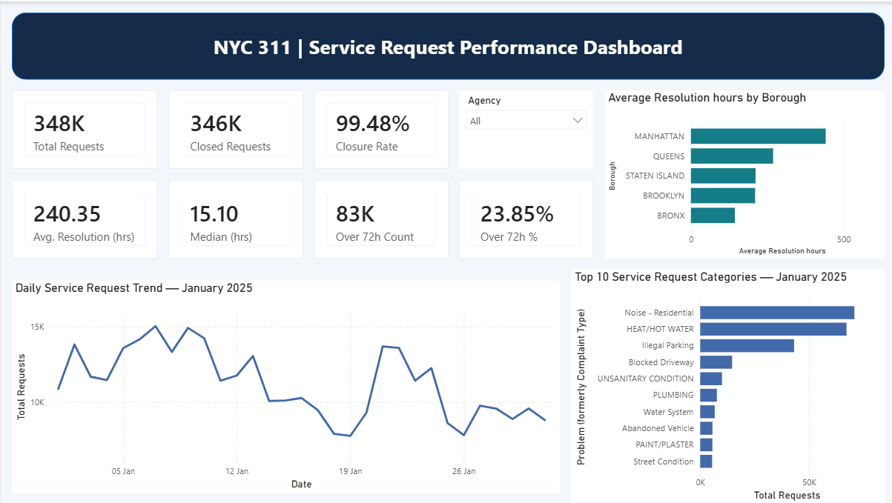

# NYC 311 Service Request Analysis | SQL & Power BI

## Project Overview

This project analyses NYC 311 service requests created during January 2025 to understand complaint patterns, agency workloads, resolution times, and service performance across New York City's boroughs.

The analysis combines SQL Server for data exploration and validation with Power BI for interactive visualisation and performance reporting.

**Project objectives:**
- Analyse service request volumes by agency, borough, and complaint category.
- Evaluate service closure rates and resolution times.
- Identify requests taking longer than 72 hours to resolve.
- Develop an interactive Power BI dashboard to support operational analysis.

## Tools and Technologies

- **SQL Server and SSMS:** Data storage, querying, aggregation, and validation.
- **SQL:** WHERE, GROUP BY, HAVING, CTEs, ROW_NUMBER(), and RANK().
- **Power BI:** Data modelling, interactive dashboards, and KPI visualisation.
- **Power Query:** Data cleaning and transformation.
- **DAX:** Calculated columns, performance measures, and time-based analysis.

## Dataset

**Source:** NYC Open Data — 311 Service Requests

**Analysis period:** January 2025

**Total records:** 348,180

The dataset includes service request IDs, complaint categories, responsible agencies, boroughs, request creation dates, closing dates, and status information.

## Data Preparation and Validation

The dataset was imported into SQL Server and prepared for analysis using Power Query.

SQL validation confirmed:

| Data Quality Metric | Result |
|---|---:|
| Total records | 348,180 |
| Distinct request IDs | 348,180 |
| Duplicate request IDs | 0 |
| Missing closing dates | 2,585 |
| Missing closing dates (%) | 0.74% |

Requests without a recorded closing date were identified as a data-quality consideration. They were not automatically classified as unresolved without examining their status.

## SQL Analysis

SQL queries were developed to:

1. Calculate total service request volume.
2. Compare request counts across agencies.
3. Analyse complaint categories handled by NYPD.
4. Evaluate request distribution by borough.
5. Filter agencies by complaint volume using HAVING.
6. Use Common Table Expressions (CTEs) to structure analytical queries.
7. Rank boroughs and agencies using ROW_NUMBER() and RANK().
8. Validate record counts, distinct identifiers, and missing closing dates.

The SQL analysis script is available in [`sql/NYC311_SQL_Analysis.sql`](sql/NYC311_SQL_Analysis.sql).

## Power BI Dashboard

An interactive dashboard was developed to monitor service request performance.



### Key Performance Indicators

| KPI | Result |
|---|---:|
| Total Requests | 348,180 |
| Closure Rate | 99.48% |
| Average Resolution Time | 240.35 hours |
| Median Resolution Time | 15.10 hours |
| Requests Over 72 Hours | Approximately 83,000 |
| Over 72 Hours Rate | 23.85% |

The dashboard includes:
- Agency filtering for comparative analysis.
- Average resolution time by borough.
- Top 10 complaint categories.
- Daily service request trends.
- Overall and agency-level performance indicators.

## Key Findings

### 1. Agency Workload

The New York Police Department (NYPD) received the largest number of recorded requests.

| Agency | Requests |
|---|---:|
| NYPD | 153,175 |
| HPD | 110,624 |
| DSNY | 26,370 |
| DOT | 16,592 |
| DEP | 15,358 |

### 2. Resolution Time Differences

The average resolution time was substantially higher than the median, indicating a right-skewed distribution in which some requests took considerably longer to close.

The median provides an additional perspective on typical service performance.

### 3. Agency Performance

NYPD recorded an average resolution time of approximately 4.93 hours, while HPD recorded approximately 395.80 hours.

These differences highlight the importance of analysing performance by agency and complaint category rather than relying only on overall averages.

### 4. Housing Complaint Patterns

Within HPD, heat and hot water complaints represented a significant share of requests.

Unsanitary condition complaints showed substantially longer resolution times, with an average of approximately 977 hours in the analysed dataset.

These observations identify categories worth further operational investigation but do not establish the underlying causes of delays.

## Recommendations

- Monitor complaint categories with consistently long resolution times.
- Investigate the distribution of requests exceeding 72 hours.
- Compare agencies using both average and median resolution times.
- Introduce category-specific performance monitoring where operationally appropriate.
- Review missing closing dates and request statuses during routine data-quality checks.

## Limitations

- The analysis covers service requests created during January 2025 and should not be treated as a full-year performance assessment.
- Differences in complaint complexity, operational responsibilities, and closure procedures limit direct comparisons between agencies.
- Requests without valid closing timestamps are excluded from calculated resolution-time averages.
- The 72-hour threshold is an analytical benchmark, not a verified service-level agreement for every complaint category.
- Reported performance metrics depend on the dataset extract and its refresh date.

## Repository Structure

```text
DA-project-1/
├── sql/
│   └── NYC311_SQL_Analysis.sql
├── powerbi/
│   └── NYC_311_Service_Analysis_Final.pbix
├── screenshots/
│   └── NYC311_Dashboard.png
└── README.md
```

The original CSV dataset is retained locally because of its large file size. Dataset access information can be provided through the NYC Open Data source.

## Skills Demonstrated

SQL querying and aggregation | Data quality validation | CTEs and window functions | Power Query | Data modelling | DAX | KPI development | Power BI dashboard design | Business insights and reporting

---

**Project Type:** Data Analytics Portfolio Project  
**Dataset:** NYC 311 Service Requests, January 2025
